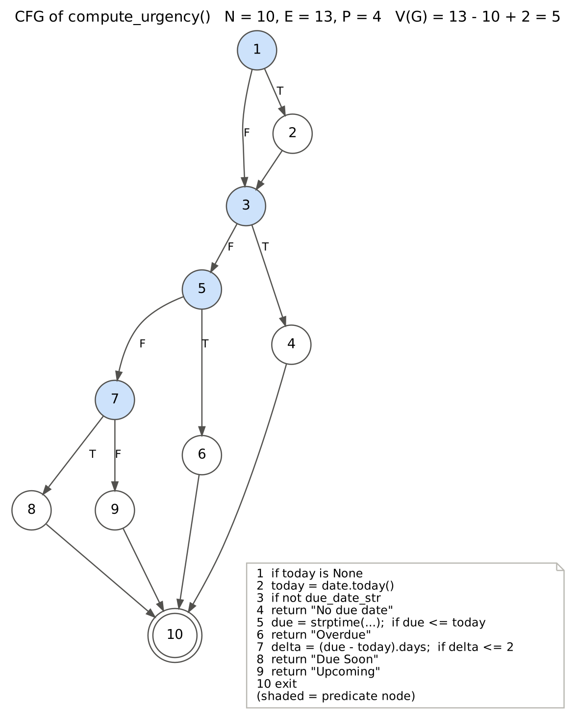

# White-Box Analysis

As the brief requires, we did not try to test the whole application structurally. We selected five units by importance, complexity and risk.

## 1. Selected units

| Unit | Why selected | V(G) | Tests |
|---|---|---|---|
| `helpers.compute_urgency` | Most important business rule; four decisions; drives badges and dashboard | 5 | TC-WB-001–008 |
| `helpers.is_valid_password` | Registration gate; boundary at 8 (one decision: `isinstance`; `len > 8` is returned, not branched) | 2 | TC-WB-009–012 |
| `helpers.is_valid_username` | Registration gate; range and character rules | 4 | TC-WB-013–018 |
| `helpers.completed_in_last_n_days` | Dashboard counter; inclusive boundary; compound condition | 4 | TC-WB-019–025 |
| `app.api_update_task` (`completed_at`) | if / elif / else that sets or clears completion time | 3 | TC-WB-026–029 |

## 2. Control-flow graph of `compute_urgency()`

Predicates: `today is None`, `not due_date`, `due <= today`, `days <= 2`.

Cyclomatic complexity agrees by all three methods:
- E − N + 2 = 13 − 10 + 2 = **5**
- predicates + 1 = 4 + 1 = **5**
- regions = **5**

V(G) = 5 (band 1–10) means a well-structured, easily testable unit that needs at most five basis-path tests.

## 3. Basis paths and boundary tests (today = 2026-11-21)

| Basis path | Meaning | Input | Expected | Test | Result |
|---|---|---|---|---|---|
| 1-3-4-10 | No due date | None | No due date | TC-WB-001 | Pass |
| 1-2-3-5-7-9-10 | today defaulted | today + 30 | Upcoming | TC-WB-002 | Pass |
| 1-3-5-6-10 | Past date | 2026-11-20 | Overdue | TC-WB-003 | Pass |
| 1-3-5-7-8-10 | 1–2 days away | 2026-11-22 | Due Soon | TC-WB-005 | Pass |
| 1-3-5-7-9-10 | 3+ days away | 2026-11-24 | Upcoming | TC-WB-007 | Pass |
| boundary of `due <= today` | Due today | 2026-11-21 | Due Today | TC-WB-004 | **Fail** (DEF-001) |

All basis paths pass, yet TC-WB-004 fails. The specification needs "Due Today", but no branch can return it, because `due <= today` sends today into the Overdue branch. This is **missing code**, which path coverage cannot reveal on its own. The other failures are TC-WB-010 (exactly 8 characters; `len > 8`; DEF-002) and TC-WB-021 (exactly 7 days; `age.days < n`; DEF-003).

**Path and data-flow notes:** there are no infeasible paths. The compound condition `age > 0 and age.days < n` was tested with each operand false (TC-WB-021, TC-WB-023). The due date is defined by the user, stored without validation, and only used later, where `strptime` raises `ValueError` (TC-WB-008). This define → store → use chain with no check is the root cause of DEF-008.

## 4. Coverage and interpretation

| Scope | Statements | Statement % | Branches | Branch % |
|---|---|---|---|---|
| helpers.py (unit tests) | 31/31 | 100% | 18/18 | 100% |
| app.py (all automated non-UI suites) | 294/299 | 98.3% | 57/64 | 89.1% |

- `helpers.py` is fully covered, yet three tests fail. **Coverage shows what code ran, not whether it is correct, and it cannot reveal missing code.**
- `app.py` uncovered lines: 242 and 266 (empty forms on GET) ran only in Selenium, which coverage does not measure. Line 375 (API `status=open` filter) was not tested; this is a known gap, listed in future testing. Lines 481–482 are the `if __name__ == "__main__"` start-up block.
- Coverage numbers come from the team's run on the lecturer's copy. Re-run the command in `README.md` to regenerate `coverage_html/`. Line numbers refer to the supplied `app.py`.
